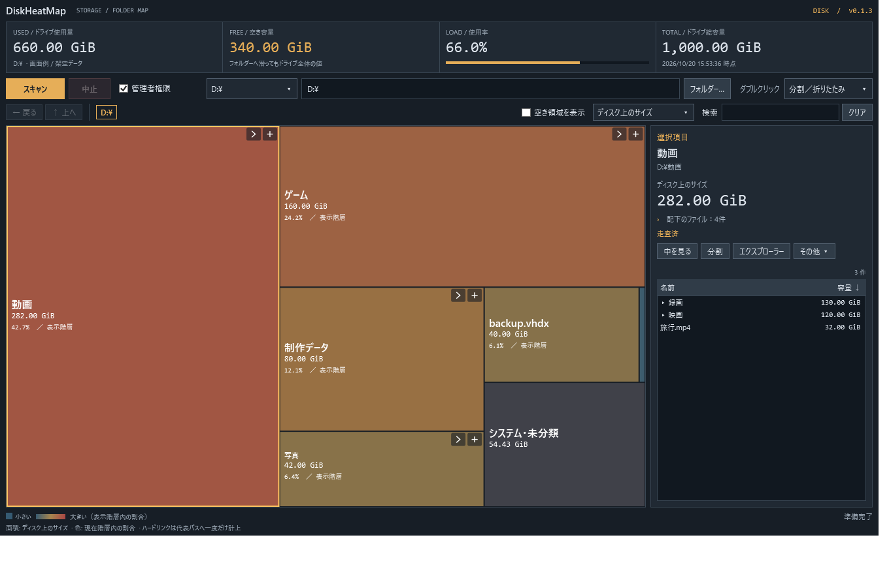
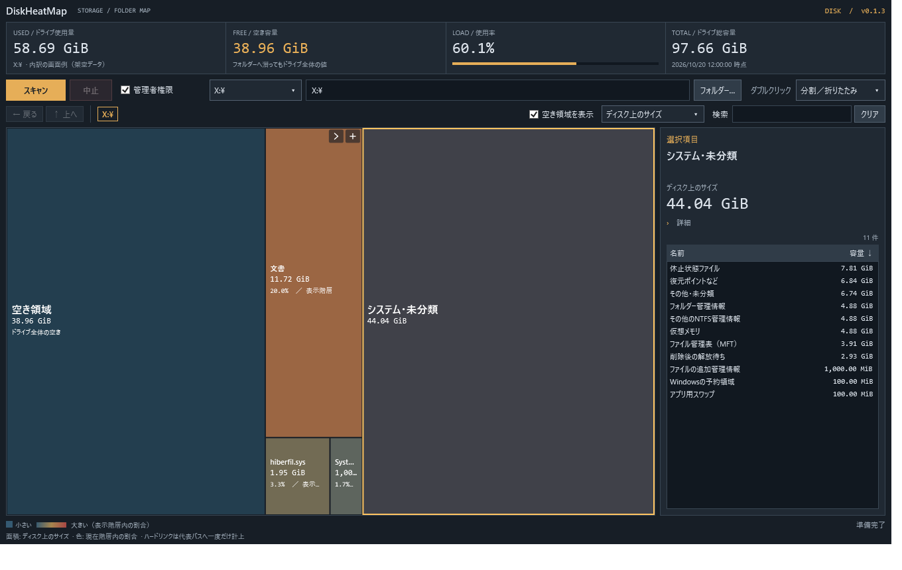

# DiskHeatMap

Windows用のディスク使用量ヒートマップです。容量の大きい場所を面積で確認し、フォルダーへ潜ったり、その場で枠を分割したりできます。日本語UI・オフライン動作。

**[最新版をダウンロード](https://github.com/mezon-web/DiskHeatMap-Releases/releases/latest)**

画面はすべて架空データです。

## 使い始める

1. Windows 11 x64で、**.NET 10 Desktop Runtime x64**を用意します。[Microsoftのダウンロードページ](https://dotnet.microsoft.com/ja-jp/download/dotnet/10.0) の「.NET Desktop Runtime」を選んでください。
2. [Releases](https://github.com/mezon-web/DiskHeatMap-Releases/releases) の `DiskHeatMap-v0.1.6-win-x64.zip` をダウンロードして展開します。
3. `DiskHeatMap.exe` を起動し、フォルダーやドライブを選んで「スキャン」。エクスプローラーからフォルダーまたはドライブ1件をドロップしても開始できます。

ランタイム非同梱の単一EXEです。ZIPにはEXEと日本語の「使い方.html」が入っています。使い方は、基本の4ステップから読める一列のHTMLです。[使い方HTMLを単体で保存](https://github.com/mezon-web/DiskHeatMap-Releases/raw/refs/heads/main/manual.html)して、オフラインでも読めます。インストーラーや常駐サービスはありません。

「管理者権限」は起動時ONで、ローカル対象のスキャン開始時にUACの確認が出ます。通常権限で使う場合はOFFにしてください。ネットワーク先は通常権限で計測し、チェックを一時的に無効化します。画面と削除操作の権限は上げません。管理者スキャンは同じWindowsユーザーの昇格に対応します。

## できること

- マップで容量の割合を確認。大きいほど暖色で表示します。
- クリックで選択、右の内訳で直下のフォルダー・ファイルを確認。ファイル数の行から詳細を開けます。
- 一覧で選んだ項目が見えるところまで親フォルダーを自動で分割し、マップに選択を表示します。一覧の対象やスクロール位置は保ちます。
- 「中を見る」で階層移動、「分割」で選んだ枠の中だけ展開。ダブルクリックの動作も切り替え可能。
- パンくず・戻る／進む・マウスのサイドボタンで移動し、選択・分割・内訳の対象を復元。
- 空き領域の表示切替、ディスク上のサイズ／通常のファイルサイズ切替、名前・パスの検索。空き表示は初回ONで、保存済みのOFF設定は引き継ぎます。
- 対応するローカル固定NTFSドライブ全体では、管理者スキャンでMFT方式を自動利用します。対象や取得状況に応じて理由を表示し、通常方式へ切り替えます。
- スキャン中は取得済みの簡略マップを滑らかに更新。選択して取得済みの情報を確認でき、「中止」も使えます。
- 左上の「計測中」チップに「／」向きの柔らかな光を流し、その下に処理段階と件数を表示。中止を押すと静止した「中止中」に変わり、処理終了時に消えます。Windowsのアニメーション設定にも従います。
- 正常に取得できた項目は「走査済」、除外や失敗は「リンク除外 ○件 · 取得不可 ○件」のように表示します。
- 「システム・未分類」を選ぶと、取得できたシステム領域の内訳と説明を右側に表示します。
- エクスプローラーで開く、パスをコピー、ファイル・フォルダー1件を「ゴミ箱へ」「完全に削除」。フォルダーは配下も対象とし、パス・容量・件数を確認してから実行します。

完全削除はごみ箱から戻せません。一括削除、スキャン起点やドライブ自体の削除には対応しません。フォルダーの配下にあるジャンクション等は参照先に入らず、リンク自体だけを対象にします。途中失敗で一部が削除済みの場合は再スキャンを案内します。

スキャンはメタデータを調べ、読めない場所・未走査・リンクの除外を区別します。管理者でも全項目を読めるとは限りません。スキャン後の外部変更は、再スキャンで取得します。HDDや別PCでの速度改善率は未検証です。

## v0.1.6の改善

UNCと割り当て済みネットワークドライブの計測・完全削除に対応しました。共有内フォルダーのドロップ、拡張UNC、区切り文字の違いを扱い、容量取得には共有パスを受け付けるWindows APIを使います。フォルダー指定時の上部表示も整理しました。[公開内容と検証範囲](RELEASE.md)

## ネットワーク共有とフォルダー使用量

- `\\NAS\共有\フォルダー` の直接入力・フォルダー選択・ドロップで開始できます。割り当て済みネットワークドライブも選択一覧に表示します。
- Windowsの現在の共有接続を使って通常権限で走査します。認証不足の場合はエクスプローラーで接続してから再試行してください。資格情報はアプリへ保存しません。
- スキャン起点が途中のフォルダー、または全体容量を取得できない場合は、左に「フォルダー使用量」を表示し、右3項目は「—」にします。フォルダーの値は選択した容量基準に従います。
- 共有先頭で全体容量を取得できる場合は、ユーザーの容量制限を含む「共有先使用量（参考）」です。共有先のマップには空き枠・システム残差を作りません。
- 共有先の削除は「完全に削除」のみです。他の利用者にも影響し、Windowsのごみ箱には入りません。NAS側のごみ箱やスナップショット等はサーバー設定に従います。リンクを含むフォルダーや、操作前の確認ができない対象は拒否します。
- スキャンが応答しない場合、中止要求から5秒の猶予後に子プロセスを終了し、受信済みの結果を残します。
- 失敗時は、書き込み可能ならEXE横の `DiskHeatMap.last-scan-error.txt` に開始方法・対象パス・版・エラー詳細を記録します。自動送信しません。

Windows SMB共有で検査しています。実NAS、Samba固有の挙動、DFS、WebDAV、NFS、別ユーザー認証は未検証です。サーバーが返す割り当て量は、NAS内部の圧縮・重複排除・RAID等を反映した実消費量とは限りません。

## 「システム・未分類」の内訳

v0.1.3でドライブ全体を再スキャンし、「システム・未分類」の枠をクリックすると、取得できた休止状態ファイル・仮想メモリ・復元ポイントなど・MFTなどの管理情報を確認できます。右の行を選び、詳細を開くと説明が表示されます。画面例は架空データです。

固定NTFSドライブ全体の計測が対象で、通常は「管理者権限」をONにすると詳しく取得できます。通常のファイル側へ計上済みの容量は差し引き、判別できない残りは「その他・未分類」に保持します。「復元ポイントなど」はSystem Volume Information全体で、すべてが復元ポイントとは限りません。内訳は説明用で、削除などのファイル操作はできません。

権限不足・出力形式・計測時点の差によっては一部を分類できません。日本語Windowsで実測しており、英語Windows実環境と他の言語での取得は未検証です。

## OneDrive

PC上に記録済みの名前・メタデータだけを集計し、ファイル本体のダウンロードやクラウド一覧の補完は行いません。「オンラインのみ」「一部をPCに保存」「PCに保存済み」を区別し、通常サイズとPCで使っている容量を切り替えられます。PC上に一覧がない場合、クラウド側も空とは判断しません。

同期領域内の削除は、クラウド側・他端末・共有している利用者にも影響します。確認画面でその影響を表示します。PCの空き容量だけを増やす操作ではありません。「ゴミ箱へ」でもWindowsのごみ箱に実体が残らない場合があり、「完全に削除」はクラウド側のごみ箱や保持データの消去を意味しません。

OneDrive実環境では読み取り専用のスキャンを確認しています。削除は専用の一時領域で検証し、実アカウントでのフォルダー削除・同期・復元と他の同期サービスの動作は未検証です。サービスによってフォルダーのごみ箱処理が完了しない場合は成功扱いにせず、完全削除へ自動で切り替えません。

## 配布ファイルとソースについて

このリポジトリは**配布案内とリリース専用**です。アプリケーションのソースコードは非公開リポジトリで管理しています。

- アプリ本体はRelease Assetsの **`DiskHeatMap-vX.Y.Z-win-x64.zip`** です。
- **`DiskHeatMap-vX.Y.Z-win-x64.zip.sha256.txt`** は、そのZIP専用のSHA-256です。照合方法は [DOWNLOAD.md](DOWNLOAD.md) を参照してください。
- GitHubが自動生成する **「Source code (zip)」「Source code (tar.gz)」は、この公開資料リポジトリの内容**です。アプリ本体やアプリのソースコードではありません。

[変更履歴](CHANGELOG.md) · [v0.1.6の公開内容](RELEASE.md)
